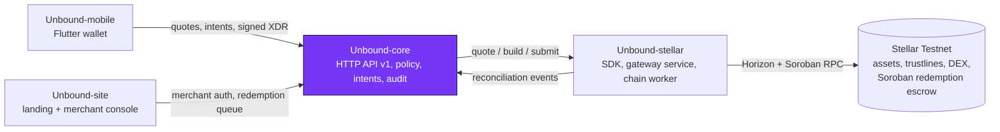

<div align="center">


# Unbound-core

**The policy and state engine behind Unbound: issuer verification, signed redemption policies, exchange intents, escrowed redemptions, disputes and an audit trail.**

[](https://github.com/Unbound224/Unbound-core/actions/workflows/ci.yml)
[](./LICENSE)
[](https://developers.stellar.org/docs/networks)
[](#tech-stack)

[Docs](https://github.com/Unbound224/Unbound-site/tree/main/gitbook) · [Live site](https://unbound-web1.vercel.app) · [Quick start](#quick-start) · [API contract](./openapi/openapi.json) · [Architecture](./docs/ARCHITECTURE.md) · [Contributing](./CONTRIBUTING.md)

</div>

## What this is

Store credit is usually stuck inside one retailer. Unbound lets a person exchange store credit that a retailer has issued and
agreed to honor for other Stellar assets, at a real order-book quote that they sign on their own device, or redeem it with the
issuer. `Unbound-core` is the system of record. It decides whether a credit is eligible (verified issuer, valid signed policy, not
revoked or expired), runs the exchange state machine from quote to confirmed or reconciling, handles redemptions and disputes, and
consumes reconciliation events from `Unbound-stellar`. It never builds or parses Stellar transactions and never sees a secret key.

Unbound is a Testnet prototype. It has had no security audit and holds no real funds.

## Status

| Capability | State |
|---|---|
| Merchant apply, admin verify with an evidence reference, revoke (revocation suspends programs at once) | Built and tested |
| Signed redemption policy (ed25519 by the issuer key, strict schema, expiry, explicit tokenization and transfer permission) | Built and tested |
| Exchange quote, intent, submit state machine (idempotency keys, write-ahead submit, `RECONCILING` on an unknown outcome) | Built, incl. concurrent duplicates |
| Escrowed redemptions through the Soroban escrow, with native return as fallback ([ADR 0002](./docs/adr/0002-redemption-escrow-mode.md)) | Run end to end on Testnet: [return](https://stellar.expert/explorer/testnet/tx/0c9b01b583a68df7a6123c1439ec29fa92375eedba41ae78cc899a9727d8f0d2) · [confirm](https://stellar.expert/explorer/testnet/tx/92eab2cd492451d1e34669d8c0d97a853d806cf6f99399630ae03af29bf258fa) · [holder timeout refund](https://stellar.expert/explorer/testnet/tx/57eef54681b43d3164e3feb9449f9f8d0154475aabbba03a59a0118101a8c4d8) |
| Exchange SHOP to USDC through core and the gateway on Testnet | Confirmed: [settlement](https://stellar.expert/explorer/testnet/tx/5879422d5f67f3388f26f525a7cadaa9640eaa1c521fed272de3fc3dfbe775e1) |
| Auth: wallet challenge and verify for consumers; scrypt passwords with lockout for merchants and admins; admin TOTP MFA | Built and unit tested; MFA has no enrolment UI yet |
| Reconciliation consumer, disputes, audit trail, maintenance jobs with run-now, single-flight lease lock | Built and tested |
| Durable SQLite behind a `Storage` port, migrations, restart tests | Built (interim store, not for scale) |
| OpenAPI 3.1 snapshot, CORS with exact origins | Built, snapshot-tested |
| Hosted instance | Free Render instance (development entrypoint, SQLite resets on redeploy): `https://unbound-core.onrender.com/v1/assets` |
| PostgreSQL, queues, rate limiting beyond login lockout, email verification, Docker image run, external audit | Not done |

The run details and every transaction link are in [`Unbound-stellar/docs/DEPLOYMENT.md`](https://github.com/Unbound224/Unbound-stellar/blob/main/docs/DEPLOYMENT.md).
Core starts only with `APP_ENV=development`; there is no hardened production mode yet.

## How it fits together



| Repository | Owns | CI |
|---|---|---|
| [Unbound-core](https://github.com/Unbound224/Unbound-core) (this repo) | Backend API: issuers, policies, intents, redemptions, audit | [](https://github.com/Unbound224/Unbound-core/actions/workflows/ci.yml) |
| [Unbound-stellar](https://github.com/Unbound224/Unbound-stellar) | Stellar SDK, gateway service, chain worker, Soroban escrow | [](https://github.com/Unbound224/Unbound-stellar/actions/workflows/ci.yml) |
| [Unbound-site](https://github.com/Unbound224/Unbound-site) | Landing page, merchant and reviewer consoles, GitBook source | [](https://github.com/Unbound224/Unbound-site/actions/workflows/ci.yml) |
| [Unbound-mobile](https://github.com/Unbound224/Unbound-mobile) | Flutter consumer wallet | [](https://github.com/Unbound224/Unbound-mobile/actions/workflows/ci.yml) |

## Tech stack

| Layer | Choice |
|---|---|
| Runtime and language | TypeScript on Node 22+ with a small `node:http` router (ADR 0001) |
| Storage | SQLite through `node:sqlite` behind a `Storage` port |
| Validation | zod schemas, strict mode |
| Contract | OpenAPI 3.1 (`openapi/openapi.json`), generated and snapshot-tested |
| Tests | Vitest: 173 tests in 21 files (`npm run check` exits 0), including cross-repo tests that run against a real `Unbound-stellar` gateway when the sibling checkout exists |

## Quick start

Requires Node 22+. Everything below runs offline with the clearly labelled `FakeStellarGateway`.

```bash
npm ci
npm run check                      # lint + typecheck + tests + build

# Local server with durable SQLite and a synthetic seed (choose your own dev-only passwords, 12+ characters)
export DATABASE_FILE=./data/dev.db \
  BOOTSTRAP_ADMIN_EMAIL=admin@example.invalid BOOTSTRAP_ADMIN_PASSWORD='change-me-admin-123' \
  SEED_MERCHANT_EMAIL=shop@example.invalid SEED_MERCHANT_PASSWORD='change-me-shop-1234'
npm run seed                       # verified merchant, SHOP credit program and a USDC target (synthetic)
npm start                          # http://127.0.0.1:3001
curl http://127.0.0.1:3001/v1/targets
```

To use a real `Unbound-stellar` gateway, also set `STELLAR_GATEWAY_URL` and `STELLAR_GATEWAY_TOKEN` (see [`.env.example`](./.env.example)).
Useful switches: `CORS_ALLOWED_ORIGINS=http://localhost:3000` for a browser on another origin, `STELLAR_ESCROW_ENABLED=true` for escrowed
redemptions, `JOBS_ENABLED=false` to turn off background jobs. Password-reset emails are printed to the server log unless `MAIL_PROVIDER=resend`.

Run the live Testnet flows (needs a running gateway and the accounts created by the `Unbound-stellar` smoke script):

```bash
node --env-file=.env --import tsx scripts/testnet-e2e.ts
node --env-file=.env --import tsx scripts/testnet-exchange.ts
```

## Project structure

```text
src/app.ts          wires services, jobs and ports
src/modules/        issuers, wallets, exchange, redemption, disputes, reconciliation, portfolio, auth
src/http/           node:http router, OpenAPI generation, CORS
src/integrations/   HttpStellarGateway (talks to Unbound-stellar)
src/persistence/    Storage port, SQLite implementation, migrations
src/jobs/           job runner and the default maintenance jobs
openapi/            openapi.json (snapshot-tested)
fixtures/           contract copies shared with Unbound-stellar (a test fails on drift)
scripts/            seed, OpenAPI generation, live Testnet runs
docs/               architecture, security, deployment, ADRs
```

## Contributing

Pick a [Stellar Wave issue](https://github.com/Unbound224/Unbound-core/issues?q=is%3Aopen+label%3A%22Stellar+Wave%22). Each has a
complexity label (`trivial`, `medium`, `high`), scope, implementation notes and acceptance criteria. Read [`CONTRIBUTING.md`](./CONTRIBUTING.md),
comment on the issue to claim it, and open a PR with `npm run check` green. Everyone follows the [Code of Conduct](./CODE_OF_CONDUCT.md).

## Security

Unaudited, Testnet only. Never use real funds or Mainnet keys with this code. Report vulnerabilities privately through the
[Security tab](https://github.com/Unbound224/Unbound-core/security); see [`SECURITY.md`](./SECURITY.md) and the threat model in
[`docs/SECURITY.md`](./docs/SECURITY.md).

## Community

Questions and ideas: [GitHub Discussions](https://github.com/Unbound224/Unbound-core/discussions).

## Maintainers

| Maintainer | Role |
|---|---|
| [@Cjay-Cyber-2](https://github.com/Cjay-Cyber-2) | Project lead and maintainer, [Unbound224](https://github.com/Unbound224) |

## Contributors

<a href="https://github.com/Unbound224/Unbound-core/graphs/contributors">
  
</a>

## License

[MIT](./LICENSE). The Unbound logo in [`brand/`](./brand) is the project's identity; it has not been trademark-cleared.
