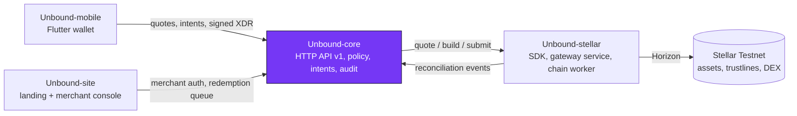

<div align="center">


# Unbound-core

**The policy and state engine behind Unbound: issuer verification, signed redemption policies, exchange intents, redemptions and reconciliation.**

[](https://github.com/Unbound224/Unbound-core/actions/workflows/ci.yml)
[](./LICENSE)
[](https://developers.stellar.org/docs/networks)
[](#project-status)

Part of **[Unbound](https://github.com/Unbound224)** - turn stranded value into something usable.

</div>

## What is Unbound?

Store credit is usually stuck inside one retailer. Unbound lets a person exchange store credit that a retailer has
**genuinely issued and agreed to honor** for other Stellar assets, at a real order-book quote that they sign on their
own device, or redeem it with the issuer.

- **Issuer-authorized only.** A verified merchant signs a redemption policy with its Stellar issuer key and must
  authorize every holder's trustline. No issuer, no usable credit; arbitrary gift cards are out of scope.
- **No fake liquidity.** Quotes come from real Stellar path payments, expire and carry a minimum-output floor. No route
  means no quote. Unbound never promises a price, liquidity or fiat cash-out.
- **Ledger-truthful.** Nothing is shown as settled until the ledger confirms it; unknown outcomes reconcile by hash.
- **Testnet only today.** Mainnet needs an external security review and legal/compliance work that has not happened.

## This repository

`Unbound-core` is the system of record. It decides **whether** a credit is eligible (verified issuer, valid signed
policy, not revoked or expired), runs the exchange-intent state machine (quote -> intent -> signature -> submit ->
confirmed / failed / reconciling) with idempotency keys, handles redemptions and disputes, and consumes
reconciliation events from `Unbound-stellar`. It never builds or parses Stellar transactions and never sees a user's
secret key.

## Architecture

Unbound is four independently tested repositories with one owner per boundary. This one is highlighted.



Clients never build Stellar transactions, and core never reimplements ledger logic. Details:
[`docs/ARCHITECTURE.md`](./docs/ARCHITECTURE.md) and [`docs/STELLAR_PROTOCOL.md`](./docs/STELLAR_PROTOCOL.md).

## Quickstart

Requires Node 22+. Everything below runs offline with the clearly labelled `FakeStellarGateway` (no Stellar network).

```bash
npm ci
npm run check                      # lint + typecheck + tests + build

# Local dev server with durable SQLite and a synthetic seed (choose your own dev-only passwords, >= 12 chars)
mkdir -p data
export DATABASE_FILE=./data/dev.db \
  BOOTSTRAP_ADMIN_EMAIL=admin@example.invalid BOOTSTRAP_ADMIN_PASSWORD='change-me-admin-123' \
  SEED_MERCHANT_EMAIL=shop@example.invalid SEED_MERCHANT_PASSWORD='change-me-shop-1234'
npm run seed                       # verified merchant + SHOP credit program + USDC target (synthetic)
npm start                          # http://127.0.0.1:3001
curl http://127.0.0.1:3001/v1/targets
```

To use a real `Unbound-stellar` gateway instead of the fake, also set `STELLAR_GATEWAY_URL` and `STELLAR_GATEWAY_TOKEN`
(see `.env.example`). Then point [Unbound-site](https://github.com/Unbound224/Unbound-site) at this server and sign in
as the seeded merchant to see the console. Useful dev switches: `CORS_ALLOWED_ORIGINS=http://localhost:3000` (browser
on another origin), `STELLAR_ESCROW_ENABLED=true` (escrowed redemptions; the fake gateway emulates the contract),
`JOBS_ENABLED=false` (no background jobs). Password-reset emails are printed to the server log, never sent.

## Project status

Legend: **Built** = implemented and covered by automated tests in this repo. **Not yet** = not started or not verified.

| Capability | Status |
|---|---|
| Merchant apply, admin verify (evidence required), revoke; revocation suspends programs immediately | Built |
| Signed redemption policy (ed25519 by the issuer key, strict schema, expiry, explicit tokenization + transfer permission) | Built |
| Durable SQLite storage behind a `Storage` port, with migrations and restart tests | Built (interim store, not for scale) |
| Auth: wallet challenge/verify for consumers; scrypt password + lockout for merchants and admins | Built |
| Exchange quote -> intent -> submit state machine (idempotency, write-ahead submit, RECONCILING on unknown outcome) | Built, incl. concurrent duplicates |
| Reconciliation consumer (contract v1.0, fail-closed, dedupe; discrepancies pause sensitive actions) | Built |
| Redemptions (confirm only after ledger-confirmed return; rejection flags a refund) and disputes | Built |
| Escrowed redemptions through the Soroban escrow (via `StellarGateway.escrow`): issuer-signed confirm/reject, holder timeout refund, `EXPIRED` state, `reconcileEscrows`; native return as fallback (ADR 0002) | Built on the labeled `FakeEscrow`; cross-repo tested against the real gateway building real Soroban XDR; never run against a deployed contract |
| CORS (`CORS_ALLOWED_ORIGINS`, exact origins, no credentials) | Built |
| Scheduled maintenance jobs (stuck intents, overdue disputes, escrow reconciliation) with backoff and admin status / run-now | Built (single process; no distributed lock) |
| Password reset (single-use hashed tokens, 30 min, throttled, ends sessions) | Built; email goes through a `Mailer` port with only the dev `OutboxMailer` (prints, never sends) |
| Admin merchant review queue and revoke endpoints | Built |
| `GET /v1/portfolio` classification; OpenAPI 3.1 snapshot; audit trail | Built |
| `HttpStellarGateway` + cross-repo tests against a real `Unbound-stellar` gateway on its simulator | Built (runs when the sibling checkout exists) |
| Docker / docker-compose | Written; only syntax-checked, never run |
| PostgreSQL, queues, distributed job lock, rate limiting beyond login lockout, real email provider, email verification, MFA | Not yet |
| Live Stellar Testnet run, production deployment, external audit | Not yet |

## Contracts

- [`openapi/openapi.json`](./openapi/openapi.json) - HTTP v1 contract (snapshot-tested).
- `fixtures/reconciliation-event.*.v1.json` - copies of the producer's (`Unbound-stellar`) golden fixture and schema; a test fails on drift.
- `fixtures/gateway/*.json` - gateway service contract (incl. the escrow endpoints), byte-identical to `Unbound-stellar`'s copy.
- [`docs/adr/0002-redemption-escrow-mode.md`](./docs/adr/0002-redemption-escrow-mode.md) - escrow mode and the native fallback.
- Idempotency: `Idempotency-Key` header on `POST /v1/exchange/intents`, `.../submit` and `POST /v1/redemptions`.

## The four repositories

| Repository | Owns | Stack | CI |
|---|---|---|---|
| [Unbound-core](https://github.com/Unbound224/Unbound-core) (this repo) | Backend API: issuers, policies, intents, redemptions, audit | TypeScript, Node 22, SQLite | [](https://github.com/Unbound224/Unbound-core/actions/workflows/ci.yml) |
| [Unbound-stellar](https://github.com/Unbound224/Unbound-stellar) | Stellar SDK, gateway service, chain worker, Soroban redemption escrow | TypeScript, @stellar/stellar-sdk, Rust/Soroban | [](https://github.com/Unbound224/Unbound-stellar/actions/workflows/ci.yml) |
| [Unbound-site](https://github.com/Unbound224/Unbound-site) | Landing page, partner docs and merchant console | Next.js 16, React 19, Tailwind 4 | [](https://github.com/Unbound224/Unbound-site/actions/workflows/ci.yml) |
| [Unbound-mobile](https://github.com/Unbound224/Unbound-mobile) | Flutter consumer wallet | Flutter, Dart, Riverpod | [](https://github.com/Unbound224/Unbound-mobile/actions/workflows/ci.yml) |

## Contributing and Drips Wave

Contributions are welcome. Start with [`CONTRIBUTING.md`](./CONTRIBUTING.md), then pick from the scoped, testable ideas in
[`docs/CONTRIBUTOR_ISSUES.md`](./docs/CONTRIBUTOR_ISSUES.md). Unbound intends to take part in
[Drips Wave](https://docs.drips.network/wave/maintainers/participating-in-a-wave/); that is subject to Drips' review and
limits, and no rewards are promised. Wave issues are opened only once their dependencies and acceptance tests are ready.
Everyone agrees to the [Code of Conduct](./CODE_OF_CONDUCT.md).

## Security

Please report vulnerabilities privately (Security tab, **Report a vulnerability**) as described in
[`SECURITY.md`](./SECURITY.md). The threat model is in [`docs/SECURITY.md`](./docs/SECURITY.md). Testnet only: never use
real funds, real customer data or Mainnet keys with this code.

## Documentation

[`docs/PRD.md`](./docs/PRD.md) (product) · [`docs/SRD.md`](./docs/SRD.md) (requirements, API, states) ·
[`docs/ARCHITECTURE.md`](./docs/ARCHITECTURE.md) · [`docs/TECHNICAL_BUILD.md`](./docs/TECHNICAL_BUILD.md) ·
[`docs/ROADMAP.md`](./docs/ROADMAP.md) · [`docs/BRAND.md`](./docs/BRAND.md) · [`AGENTS.md`](./AGENTS.md) (rules for coding agents).
The canonical copy of the shared docs lives in [Unbound-core](https://github.com/Unbound224/Unbound-core/tree/main/docs).

## License

[MIT](./LICENSE). The Unbound logo in [`brand/`](./brand) is the project's approved identity and is shared by all four
repositories; it has not been trademark-cleared.
